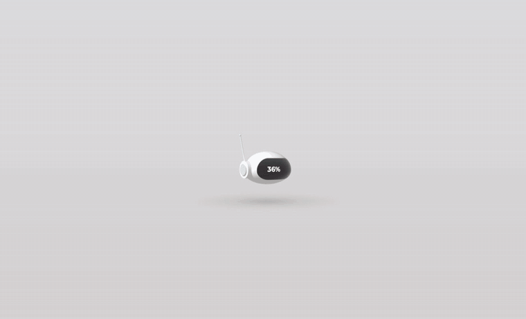
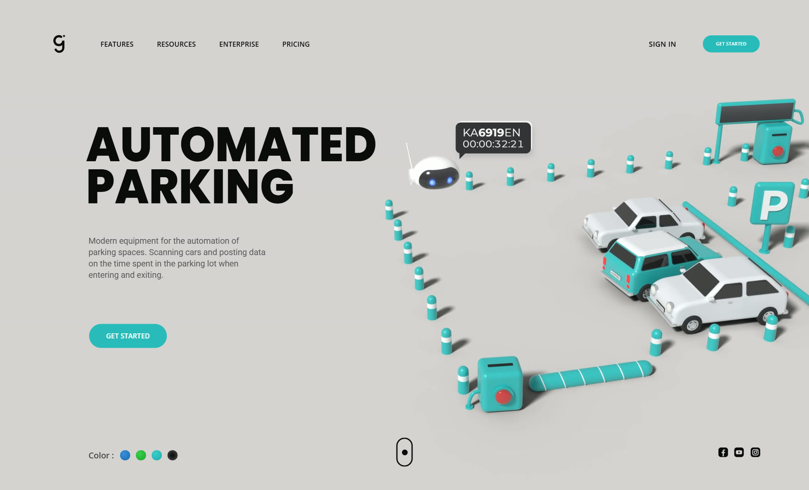
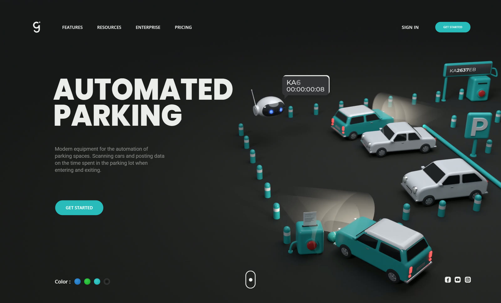
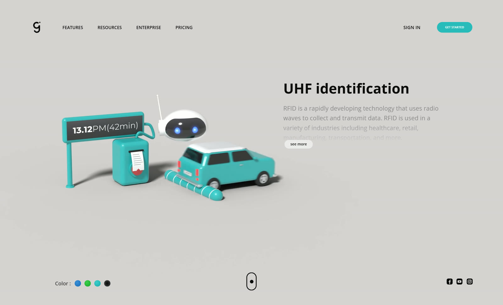
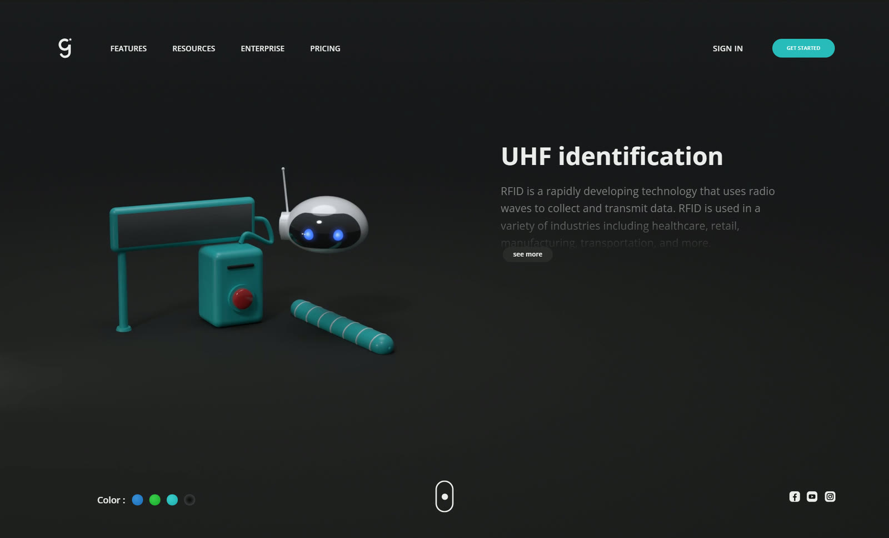
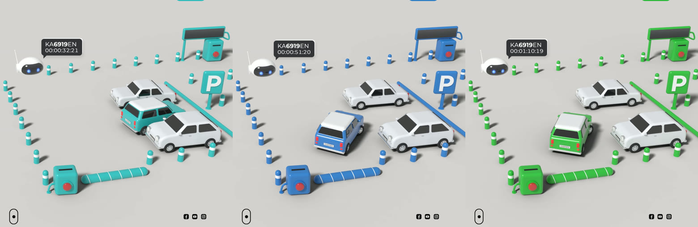
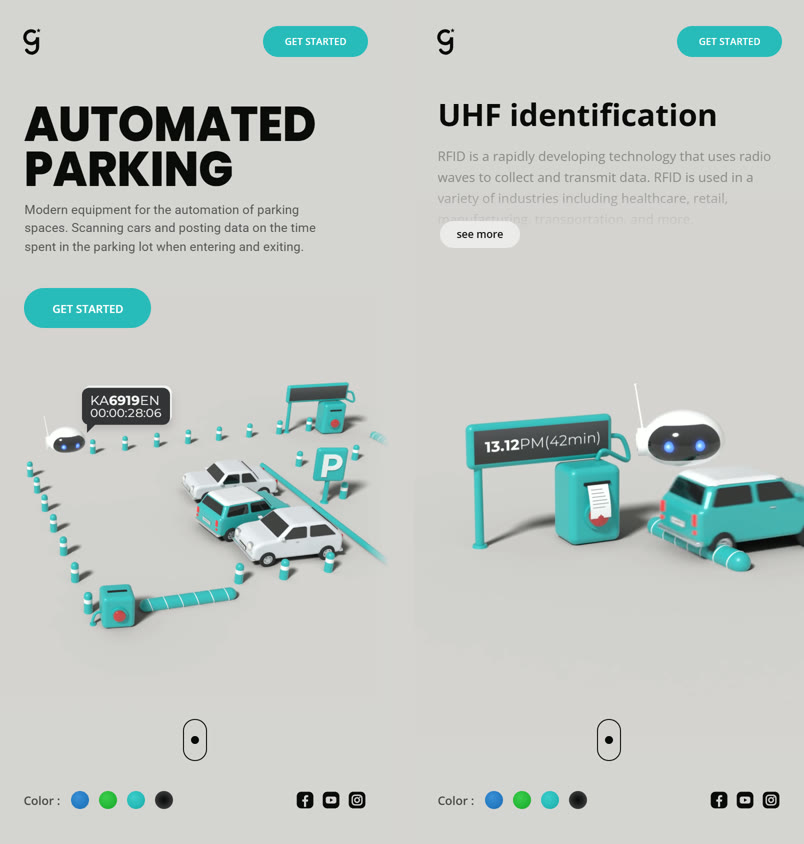
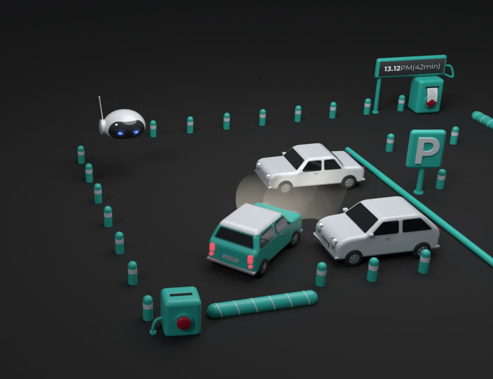

# Automated Parking — site 3D

Landing page « Automated Parking » animée en 3D : loader avec le robot, rideau
d'entrée, parking automatisé en boucle, sélecteur de couleurs, mode nuit, section
« UHF identification » et défilement section par section.

**[Voir le site en ligne](https://pdha8.github.io/automated-parking-3d/)**



La 3D est **rendue dans Blender (Cycles, GPU)** puis lue dans le site sous forme
de vidéos en boucle : rendu de qualité « studio » et lecture parfaitement fluide
sur n'importe quel ordinateur (décodage vidéo matériel). L'interface (textes,
boutons, bulle du robot, curseur…) reste en HTML/CSS/JS.

## Aperçu

| Jour | Nuit |
| --- | --- |
|  |  |
|  |  |

### Trois couleurs d'accent

Chaque couleur a sa propre vidéo Blender ; le changement est instantané et
l'animation continue sans saut.



### Mobile



### Rendu Blender

Mode nuit : faisceaux des phares, écrans lumineux, ombres douces (Cycles + OptiX).



## Fonctionnalités

- Loader : le robot flotte, sa visière affiche le pourcentage
- Rideau d'entrée et apparition du titre ligne par ligne
- Parking animé en boucle de 9 s (voitures, scan des plaques, barrières, reçus)
- Bulle du robot synchronisée image par image avec la vidéo (plaque tapée + chrono)
- Couleurs teal / bleu / vert et mode nuit
- Section « UHF identification » avec texte en cascade et bouton « see more »
- Défilement section par section (molette, clavier, tactile), curseur personnalisé
- Version mobile adaptée

## Lancer le site

Prérequis : Node.js 20.19 ou plus récent.

```bash
npm install
```

```bash
npm run dev
```

Puis ouvrir http://localhost:5173

## Version de production

```bash
npm run build
```

Le site final est généré dans `dist/` (fichiers statiques, vidéos comprises) :
il peut être déposé sur n'importe quel hébergement (GitHub Pages, Netlify, Vercel…).
Sur GitHub, le workflow `.github/workflows/deploy.yml` publie automatiquement le
site sur GitHub Pages à chaque push sur `main`.

```bash
npm run preview
```

## Ouvrir les scènes dans Blender

Les scènes prêtes à ouvrir sont dans `blender/scenes/` : `hero_teal.blend`
(parking), `gate_teal.blend` (section « UHF identification ») et leurs versions
nuit (`_dark`). Les écrans et la visière du robot lisent leurs images dans
`blender/work/`. Ce dossier n'est pas inclus dans le dépôt (trop lourd) : il se
recrée avec l'export décrit ci-dessous (étape 1).

## Refaire le rendu 3D avec Blender

Les vidéos sont dans `public/video/`. Pour les régénérer (Blender 5.x requis) :

1. `npm run dev`, puis ouvrir http://localhost:5173/?export : les scènes (géométrie,
   animation image par image, écrans, visière du robot) sont exportées dans
   `blender/work/`. Pour une seule scène : `?export=hero`, `?export=gate` ou
   `?export=loader`.
2. Position de la bulle du robot, calculée avec la caméra Blender
   (écrit `src/data/hero-bubble.json`) :

```bash
blender -b --factory-startup -P blender/bubble.py
```

3. Rendre et encoder toutes les variantes :

```bash
bash blender/render_all.sh
```

Variantes : `hero_teal`, `hero_blue`, `hero_green`, `hero_teal_dark` et la même
chose pour `gate_*` (section « UHF identification »). On peut en passer une
partie en argument, par exemple `bash blender/render_all.sh hero_teal`.
Compter environ 12 min par variante avec une RTX 4060.

4. Images fixes affichées si la lecture automatique est bloquée (première image
   de chaque vidéo) :

```bash
bash blender/posters.sh
```

Le script `blender/render.py` règle la caméra (calculée à partir de la vidéo de
référence), l'éclairage studio, le sol « attrape-ombre », les phares du mode nuit
et rend avec Cycles sur la carte graphique (OptiX).

## Structure

| Élément | Fichier |
| --- | --- |
| Orchestration (chargement, intro, sections, couleurs) | `src/main.js` |
| Vidéos 3D par variante, changement de couleur synchronisé | `src/ui/videoScene.js` |
| Bulle du robot synchronisée image par image | `src/ui/bubble.js` + `src/data/hero-bubble.json` |
| Loader (robot rendu dans Blender + pourcentage) | `src/ui/loader.js` |
| Animation d'entrée du titre / bouton | `src/ui/hero.js` |
| Défilement section par section | `src/ui/sections.js` |
| Texte « UHF identification » + « see more » | `src/ui/uhf.js` |
| Curseur étoile + anneau | `src/ui/cursor.js` |
| Scènes 3D source (Three.js) utilisées pour l'export | `src/three/` |
| Export vers Blender | `src/dev/exporter.js` |
| Rendu Blender | `blender/render.py`, `blender/render_all.sh`, `blender/bubble.py` |

## Personnaliser

- **Couleurs de l'interface** : `src/core/theme.js` (`ACCENTS`) et `src/styles/main.css` (`:root`)
- **Textes** : `index.html`
- **Scène 3D** (trajets, plaques, lumière) : `src/three/` puis refaire l'export et le rendu

## Outils de mise au point (mode `npm run dev`)

- `?nointro` : saute le loader
- `?section=1` : ouvre directement la section « UHF identification »
- `?export` : exporte les scènes 3D pour Blender (`?export=gate` : une seule scène)
